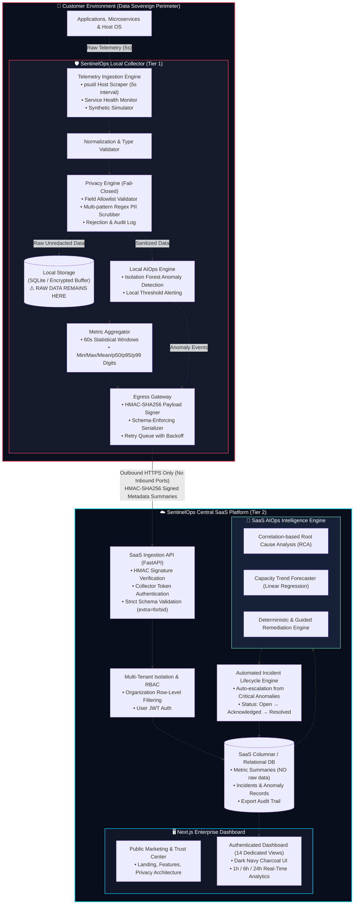

# 🛡️ SentinelOps Architecture Specification

> **Tagline:** *Observe Locally. Understand Globally.*  
> **Project Type:** Privacy-First, AI-Powered, Two-Tier SaaS Observability Platform

---

## 1. Executive Summary & Design Principles

SentinelOps is architected around the fundamental tenet of **Data Sovereignty**. In traditional observability platforms, high-volume raw telemetry (system metrics, raw logs, tracing spans, and application profiling) is shipped directly to cloud vendors. This introduces:
1. **Severe Security & Compliance Risks**: Raw logs frequently contain Personally Identifiable Information (PII), database credentials, session tokens, JWTs, bearer authorization headers, and customer query strings.
2. **Bandwidth & Cloud Ingestion Inefficiencies**: Sending high-frequency per-second raw data over WAN inflates egress bills and processing costs.

### The SentinelOps Paradigm:
* **Observe Locally**: A lightweight, containerized local collector sits inside the customer environment. It scrapes operating system and application metrics, tails logs, performs statistical rolling aggregations, executes local Isolation Forest anomaly detection, scrubs PII, enforces a strict fail-closed allowlist, and stores raw data locally in SQLite.
* **Understand Globally**: Only cryptographically signed, schema-validated, anonymized statistical summaries (p50/p95/p99), health indicators, ML anomaly signals, and alert metadata are transmitted to the cloud-hosted SaaS platform via outbound HTTPS.

---

## 2. Two-Tier System Architecture

---

## 3. Data Boundary: Stays Local vs. Leaves

| Data Category | Stays Local (Tier 1 Only) | Sent to SaaS Cloud (Tier 2 Egress) |
|---|---|---|
| **System Metrics** | Raw per-second CPU core readings, exact memory byte allocations, disk sector I/O | Aggregated 60s windows: count, min, max, mean, p50, p95, p99 |
| **System Logs** | Raw log lines, stack traces, SQL error statements, unparsed text | Aggregated pattern counts, normalized signature frequencies, total error counts |
| **Sensitive Values** | Passwords, bearer tokens, API keys, email addresses, credit cards, SSNs, IPs | **STRICTLY BLOCKED & REDACTED** — fail-closed rejection |
| **Application State** | Raw payload request bodies, URL query strings, internal headers | Health status indicators (healthy, degraded, down), latency summary buckets |
| **AIOps & Alerts** | Full high-dimensional feature matrices, raw isolation scores | Anomaly alert payloads (score, severity, metric name, expected range, action) |
| **Governance** | Local execution logs, detailed field drop audit | Aggregate audit statistics (records processed, fields approved, fields dropped) |

---

## 4. Privacy Engine: Fail-Closed Allowlisting

Unlike naive regex-only approaches, SentinelOps implements **two independent layers of privacy enforcement**:

1. **Object Reconstruction from Strict Allowlist**:
   The collector never serializes internal runtime objects. Instead, it creates **new Pydantic objects** populated only with allowlisted attributes. Any unrecognized attribute in runtime memory is rejected before construction.
2. **Deep Content Sanitization**:
   All string fields, metric label keys, and label values are recursively evaluated against pre-compiled regex detectors for:
   - Email addresses (`[a-zA-Z0-9_.+-]+@[a-zA-Z0-9-]+\.[a-zA-Z0-9-.]+`)
   - IPv4 addresses (`\b(?:\d{1,3}\.){3}\d{1,3}\b`)
   - JWT tokens (`eyJ[A-Za-z0-9_-]+\.eyJ[A-Za-z0-9_-]+\.[A-Za-z0-9_-]+`)
   - API keys and tokens (`(?:sk|pk|api[_-]?key)[_-][A-Za-z0-9]{16,}`)
   - Credit card numbers & SSNs
   - Key name blocklists (`password`, `authorization`, `secret`, `cookie`, `session`)
3. **Audit Trail**: Every drop, redaction, or rejection is logged in the local `export_audit` SQLite database with counts transmitted for compliance verification.

---

## 5. AIOps Intelligence Engine Architecture

The AIOps intelligence is split purposefully between Edge and Cloud:

### Tier 1: Local Anomaly Detection (Isolation Forest)
- **Feature Engineering**: For each metric stream, creates rolling features: `[value, rolling_mean_5, rolling_std_5, diff_1, diff_2]`.
- **Isolation Forest**: Identifies local outliers with `contamination=0.01`. Produces decision function score $s \in [-1, 1]$.
- Scores below $-0.5$ produce Warnings; scores below $-0.8$ produce Critical alerts.

### Tier 2: SaaS Cross-Metric Root Cause Analysis (RCA)
- **Correlation Matrix**: When anomalies co-occur in the same time window, the RCA engine measures pairwise cross-correlations across CPU, Memory, Latency, Error Rate, and Service Health.
- **Hypothesis vs. Confirmed**: Clear evidentiary distinctions are assigned. A pattern with 1 supporting indicator is tagged as *Hypothesis*; patterns matching known failure modes with $\ge 2$ correlated indicators are marked *Probable Root Cause*.
- **Predictive Horizon**: Linear regression on metric velocity projects capacity exhaustion time (e.g. disk full in 4.2 hours).
- **Remediation**: Deterministic playbook actions generated based on exact indicator signatures.

---

## 6. Security & Multi-Tenancy Model

- **No Inbound Collector Ports**: The collector operates inside firewalled customer infrastructure and initiates outbound HTTPS requests only.
- **Cryptographic Authentication**:
  - Each collector is provisioned with a unique, one-time enrollment token and receives an API Key and an HMAC Secret.
  - Every outbound payload is signed with HMAC-SHA256 (`X-HMAC-Signature`).
  - SaaS verifies tenant identity and HMAC signature before passing data to the ingestion parser.
- **Tenant Isolation**: Every database table is indexed and foreign-keyed on `org_id`. Ingestion, dashboard, and analytical queries enforce row-level scoping.
- **Schema-Enforced Ingestion**: SaaS uses Pydantic with `model_config = ConfigDict(extra="forbid")`. Any payload containing unexpected fields is immediately rejected with HTTP 422.
